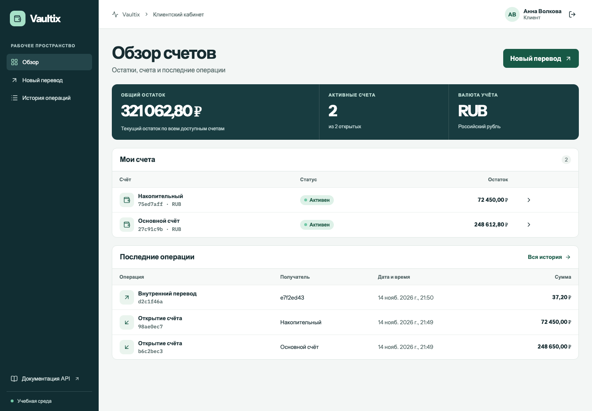

# Vaultix

Учебная банковская транзакционная платформа / Educational banking transaction platform.

**[Русский](README.ru.md) · [English](README.en.md)**

Внутренние переводы RUB, двойная запись в PostgreSQL, рабочие кабинеты клиента и оператора и лаборатория с восемью воспроизводимыми сценариями. Все данные синтетические.

Internal RUB transfers, a PostgreSQL double-entry ledger, customer and staff workspaces, and eight reproducible reliability scenarios. All data is synthetic.

```sh
docker compose up --build
```

[Открыть локальный стенд / Open local demo](http://127.0.0.1:8080) · [Архитектура / Architecture](docs/architecture/system.md) · [Трассируемость / Traceability](docs/testing/traceability.md)


